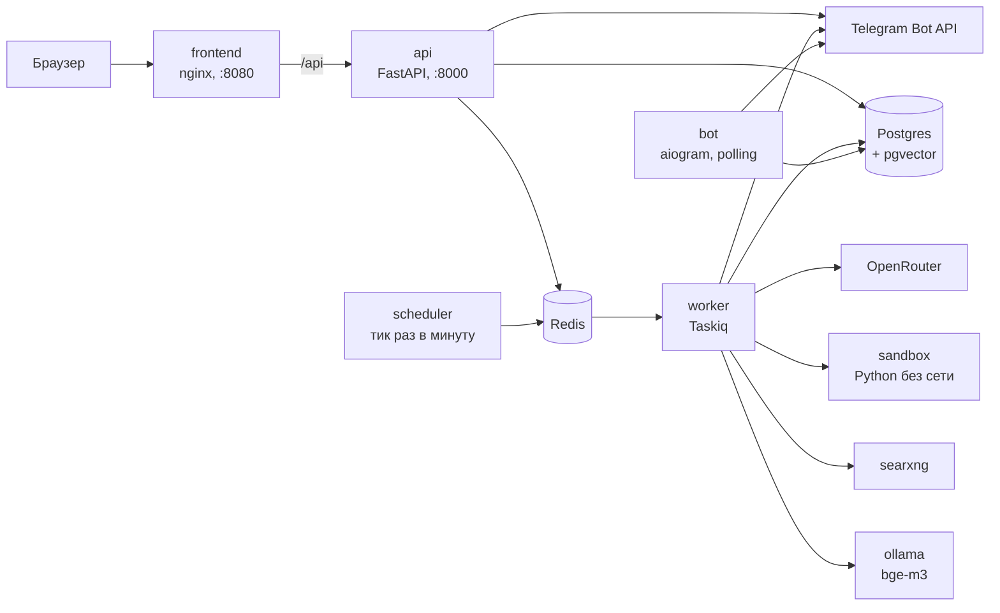
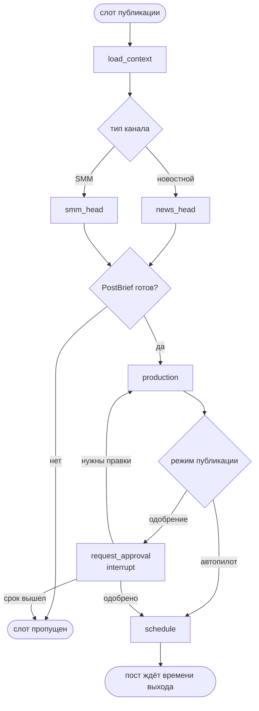
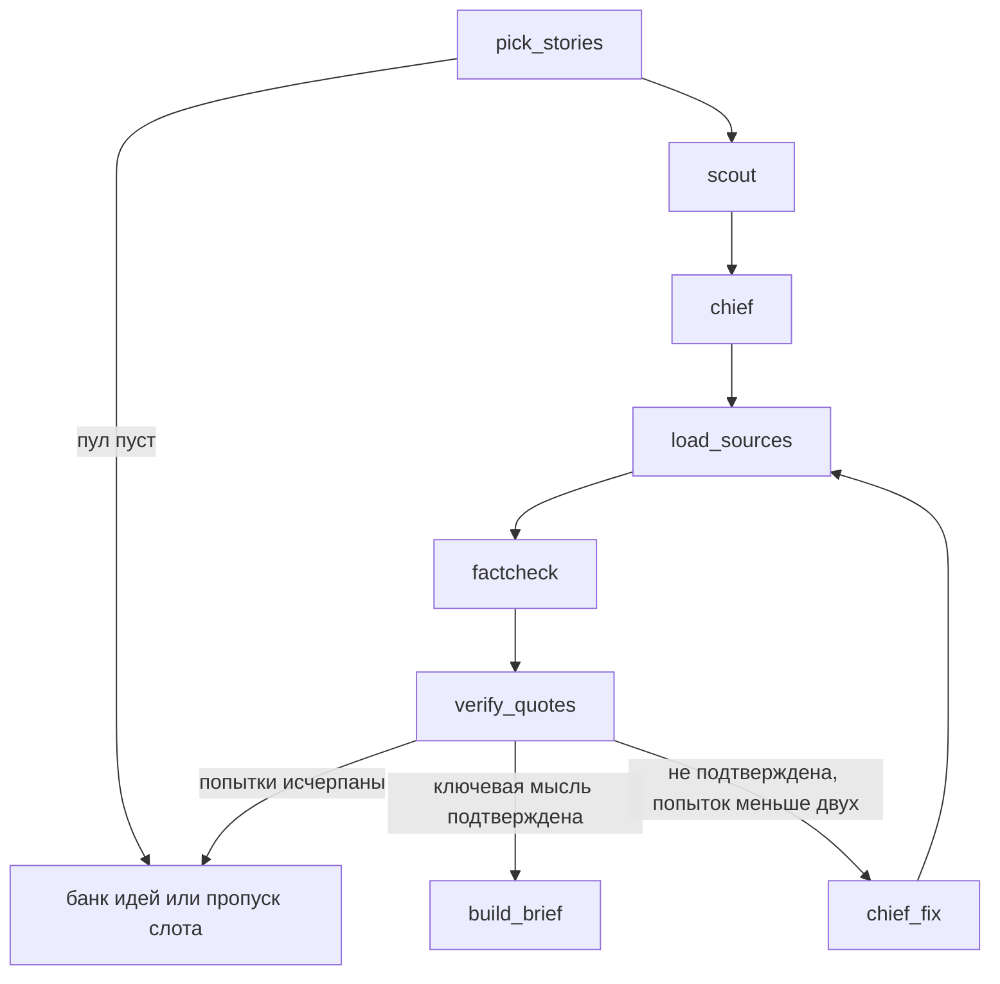
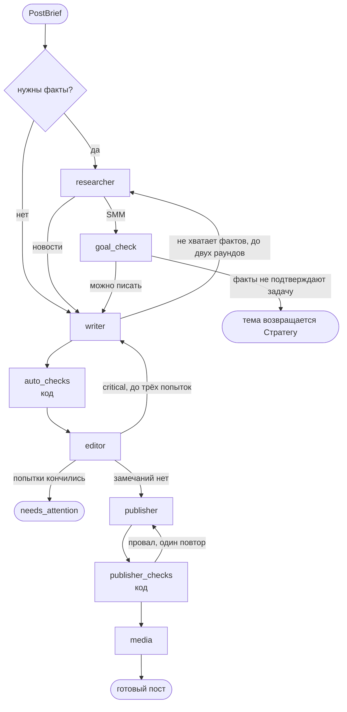

# AI-отдел для Telegram-каналов

Выпускной проект курса LLM Driven Development. Сервис автоматически ведёт Telegram-канал: подбирает темы, ищет факты, пишет посты, проверяет их и публикует. Пользователь регистрируется, подключает канал, заполняет бриф и выбирает режим публикации. В режиме автопилота посты выходят без участия пользователя, в режиме одобрения каждый пост сначала ждёт его решения в личном кабинете.

Главная цель проекта: тексты постов не должны отличаться от написанных человеком. Поэтому, кроме самой генерации, в систему встроены проверки результата: словарь штампов, поиск характерных для нейросетей конструкций, Редактор и проверки кодом. Они описаны в разделе «Качество текста».

## Возможности

Каналы бывают двух типов: SMM и новостной. Тип выбирается при создании и потом не меняется.

| | SMM-канал | Новостной канал |
|---|---|---|
| Источник тем | Недельный контент-план, который составляет Стратег, и банк идей | Пул сюжетов из RSS-лент пользователя |
| Ритм публикаций | Слоты плана | Сетка слотов (например, три поста в день) |
| Проверка фактов | После исследования проверяется, что найденные факты подтверждают задачу слота | До написания: Фактчекер сверяет сюжет с источниками, а цитаты код проверяет дословно |
| Ежемесячная работа | Аналитик считает реакции и оценки по рубрикам, Стратег предлагает изменения в стратегии | Не выполняется |

Форматы поста: обычный (текст с картинкой или графиком), опрос и подборка со ссылками. Публикация выполняется через Telegram Bot API.

В кабинете также есть бриф с подсказками, стайлгайд канала, редактирование промптов каждой роли с историей версий, выбор модели для каждой роли, календарь контент-плана, пул сюжетов, учёт расходов по постам и ролям с месячным бюджетом и страница запуска со схемой графа, на которой шаги агентов видны в реальном времени.

## Архитектура

### Сервисы



Postgres хранит каналы, слоты, посты, сюжеты, векторы (pgvector), чекпоинты LangGraph, события запусков и все вызовы моделей. Redis используется как брокер очереди задач и как канал для событий запусков. Данных, которые нельзя потерять, в нём нет: время публикации хранится в базе, а планировщик раз в минуту выбирает из неё наступившие слоты.

Worker выполняет графы. Если контейнер остановился во время запуска, запуск продолжится с последнего завершённого узла, потому что состояние хранится в чекпоинтере LangGraph. Bot принимает обновления от Telegram: привязку аккаунта владельца, реакции на посты, результаты опросов и переименование канала. Sandbox выполняет Python-код агентов (графики Издателя, расчёты Аналитика) в контейнере без доступа к сети, с ограничениями по памяти и числу процессов.

Фоновые задачи выполняются по расписанию:

| Когда | Что |
|---|---|
| Каждую минуту | Публикация наступивших постов, старт слотов, автоутверждение планов, закрытие просроченных одобрений, повтор отложенных запусков |
| Каждые 5 минут | Опрос RSS-лент |
| Ежедневно в 03:17 | Обновление каталога моделей OpenRouter |
| По понедельникам в 04:30 | Составление правил канала из ручных правок пользователя |
| 1-го числа в 06:00 | Месячный отчёт Аналитика |

Время в таблице указано по UTC. Расписание публикаций канала задаётся в его местном времени.

### Граф поста

В системе четыре графа: `post`, `planning`, `onboarding` и `analytics`. Граф `post` выполняется для каждого слота публикации. Для новостного и SMM-канала он собирается отдельно, поэтому в нём нет узлов чужого типа, а страница запуска показывает ровно тот граф, который выполняется.



Подграфы `news_head` и `smm_head` передают дальше одну и ту же структуру `PostBrief`, поэтому общее производство не зависит от типа канала.

`news_head` выбирает сюжет и проверяет его по источникам:



`smm_head` состоит из двух узлов: слот плана уже содержит тему и задачу, которые определил Стратег.

Общее производство (`production`):



Если после трёх попыток у поста остались критичные замечания, он не публикуется автоматически даже в режиме автопилота. Пост получает статус «требует внимания» и вместе со списком замечаний ждёт решения пользователя.

Все циклы ограничены по числу повторов. При сбоях используются запасные варианты: цепочка моделей в OpenRouter, поиск через SearXNG и затем DuckDuckGo.

### Роли

В системе тринадцать ролей. По умолчанию для ролей, от которых зависит текст поста, выбрана более сильная модель, а для проверок и вспомогательных задач более дешёвая. В настройках канала модель можно заменить для каждой роли отдельно, выбрав её из каталога OpenRouter.

| Роль | Что делает | По умолчанию |
|---|---|---|
| Аккаунт-менеджер | Проверяет бриф на осмысленность, помогает его сформулировать | `anthropic/claude-sonnet-5` |
| Оформитель | Составляет стайлгайд канала | `anthropic/claude-sonnet-5` |
| Стратег | Составляет стратегию, недельный план, темы для слотов, правила канала из правок, предложения по итогам месяца | `anthropic/claude-sonnet-5` |
| Шеф-редактор | Выбирает сюжет и формулирует, что читатель должен вынести из поста | `anthropic/claude-sonnet-5` |
| Писатель | Пишет текст | `anthropic/claude-sonnet-5` |
| Редактор | Проверяет текст на соответствие стайлгайду, фактам и позициям канала | `anthropic/claude-sonnet-5` |
| Скаут | Оценивает значимость сюжетов | `anthropic/claude-haiku-5.5` |
| Фактчекер | Сверяет утверждения с источниками | `anthropic/claude-haiku-5.5` |
| Исследователь | Ищет и читает страницы, собирает факты с цитатами | `anthropic/claude-haiku-5.5` |
| Издатель | Оформляет текст и расставляет эмодзи, не меняя сам текст | `anthropic/claude-haiku-5.5` |
| Аналитик | Считает статистику канала и делает выводы | `anthropic/claude-haiku-5.5` |
| Страж | Проверяет внешний текст на попытки prompt injection | `anthropic/claude-haiku-5.5` |
| Новизна | Решает спорные случаи при сравнении темы с прошлыми постами | `anthropic/claude-haiku-5.5` |

Для каждой роли задана запасная модель, которую OpenRouter использует, если основная недоступна. Рассуждение моделей по умолчанию выключено, потому что оно оплачивается как выходные токены. Для отдельной роли его можно включить в настройках канала.

### Инструменты агентов

Агентам доступны веб-поиск (SearXNG, при его недоступности DuckDuckGo, а также Wikipedia), чтение страницы по ссылке, поиск по прошлым постам канала, `calculate` для вычисления любых производных чисел и Python в песочнице. Числа в посте, которых нет в источниках, должны быть получены через `calculate`, иначе проверка кодом вернёт текст на доработку. Изображения берутся с Pexels.

### Векторный поиск (pgvector)

Postgres работает с расширением pgvector. Эмбеддинги считает модель `bge-m3` через Ollama (1024 измерения), они хранятся в колонках типа `vector`, а для записей лент и постов построены HNSW-индексы по косинусной близости. Векторы нужны для трёх задач:

- Объединение записей в сюжеты. Новая запись из ленты сравнивается с сюжетами, которые обновлялись за последние 48 часов. При сходстве от 0,85 запись относится к существующему сюжету, при сходстве от 0,72 до 0,85 вопрос решает роль «Новизна», при меньшем сходстве создаётся новый сюжет. Так одна новость из нескольких лент не превращается в несколько постов.
- Проверка новизны. Тема сравнивается с опубликованными, запланированными и ожидающими одобрения постами канала. Сходство от 0,86 считается повтором. При сходстве от 0,70 до 0,86 роль «Новизна» решает, повтор это, развитие прошлого поста (тогда новый пост ссылается на прошлый) или новая тема. Проверка выполняется для сюжетов новостного канала и для тем слотов SMM-плана. Для этого у каждого поста сохраняется эмбеддинг его заголовка, ключевой мысли и первых 1500 символов текста.
- Поиск по прошлым постам. Инструмент `search_past_posts` превращает запрос агента в вектор и возвращает ближайшие посты канала со сходством от 0,45, чтобы агент не повторял уже написанное и мог на него сослаться.

## Качество текста

За качество текста отвечает несколько механизмов.

**Детектор штампов** — обычный код без LLM. Он запускается до Редактора, и найденные проблемы передаются Редактору как готовые замечания. Детектор ищет:

- обороты-штампы из словаря с учётом словоформ (pymorphy3); словарь можно расширять в настройках сервиса;
- характерные конструкции: «не X, а Y» и «это не просто X, это Y» чаще одного раза, цепочки тире, тройки однородных членов, риторические вопросы, подзаголовки вида «Как это работает.», нравоучительные концовки;
- латинские слова, которых нет в белом списке названий;
- однообразную длину предложений и абзацев (в тексте, написанном человеком, она заметно меняется);
- символы вместо слов (`/`, `~`, стрелки) и смешение «ты» и «вы».

Каждое срабатывание становится критичным замечанием с цитатой фрагмента.

**Проверки кодом.** Кроме детектора, код проверяет длину поста, запрещённые слова канала, обращение на «ты» или «вы», хвост поста, политику ссылок, дословное наличие цитат в источнике, происхождение чисел из `calculate` и то, что Издатель не изменил текст. Строку «Источник», подпись и хештеги добавляет код при вёрстке, а Писатель пишет только основной текст.

**Голос канала.** Писатель получает несколько постов из каналов-ориентиров, указанных в брифе, как образец манеры письма (не содержания), а также одобренные пользователем посты без правок. Ручные правки пользователя сохраняются в виде «было → стало», и раз в неделю Стратег объединяет их в короткие правила канала. Пользователь видит эти правила и может удалить любое из них.

**Защита от инъекций.** Внешний текст проходит эвристики и классификатор и передаётся агентам внутри тегов `<data>`. Закрытая часть промпта (формат ответа, правила инструментов) не редактируется и всегда берётся из кода.

## Запуск

Для запуска нужны Docker с Compose v2, ключ [OpenRouter](https://openrouter.ai) и токен бота от [@BotFather](https://t.me/BotFather). Потребуется несколько гигабайт свободного места под образы и модель эмбеддингов.

Сначала создайте файл `.env` из шаблона:

```bash
cp .env.example .env
```

В PowerShell эквивалентная команда: `Copy-Item .env.example .env`. Заполните в файле как минимум `OPENROUTER_API_KEY` и `TELEGRAM_BOT_TOKEN`, а значение `APP_SECRET` замените на длинную случайную строку.

Затем запустите сервисы:

```bash
docker compose up -d --build
```

После запуска интерфейс доступен по адресу http://localhost:8080. Первый запуск занимает несколько минут: собираются образы, а Ollama скачивает модель `bge-m3` (около 1,2 ГБ). Пока модель не скачана, не работают объединение новостей в сюжеты и проверка новизны. Миграции базы сервис `api` применяет сам при старте.

Переменные `.env`:

| Переменная | Обязательна | Назначение |
|---|---|---|
| `OPENROUTER_API_KEY` | да | Все вызовы моделей |
| `TELEGRAM_BOT_TOKEN` | да | Подключение каналов, публикация, реакции. Без него контейнер `bot` простаивает, и канал в кабинете подключить нельзя |
| `APP_SECRET` | да | Подпись токенов входа |
| `PEXELS_API_KEY` | нет | Стоковые изображения. Без ключа посты выходят без них |
| `LANGFUSE_PUBLIC_KEY`, `LANGFUSE_SECRET_KEY`, `LANGFUSE_BASE_URL` | нет | Трассировка в Langfuse. Адрес по умолчанию: `https://cloud.langfuse.com` |
| `POSTGRES_PASSWORD`, `REDIS_PASSWORD`, `SEARXNG_SECRET` | нет | Заданы значения по умолчанию. Порты баз данных доступны только с `127.0.0.1`, но при размещении на сервере пароли нужно заменить |

Порты, доступные на хосте:

| Порт | Сервис |
|---|---|
| 8080 | Интерфейс |
| 8000 | API, документация по адресу `/docs` |
| 8888 | SearXNG |
| 11434 | Ollama |
| 5432, 6379 | Postgres и Redis |
| 1200 | RSSHub, только с профилем `rsshub` |

[RSSHub](https://docs.rsshub.app) создаёт RSS-ленты для сайтов и соцсетей, у которых их нет. В проект он входит как необязательный сервис и запускается отдельным профилем: `docker compose --profile rsshub up -d`. Автоматической интеграции с ним пока нет: адрес ленты берётся из маршрутов RSSHub (`http://rsshub:1200/<маршрут>`) и добавляется в канал как обычная лента.

Остановить сервисы можно командой `docker compose down`. Данные хранятся в томах и сохраняются. Чтобы удалить и их, добавьте флаг `-v`.

## Как пользоваться

1. Откройте http://localhost:8080 и зарегистрируйтесь по email и паролю (не короче 8 символов).
2. Нажмите «Новый канал» и выберите его тип. Затем выполните три шага:
   - привяжите свой Telegram-аккаунт: кнопка «Открыть бота и привязать» открывает бота, в нём нужно нажать Start, так сервис проверит, что вы администратор канала;
   - добавьте бота сервиса в администраторы канала с правом публикации сообщений;
   - укажите `@username` канала. Название канала сервис берёт из Telegram и обновляет при переименовании.
3. Заполните бриф: о чём канал, для кого он, цель, как писать, чего избегать. К каждому полю есть пример и кнопка «Помочь сформулировать». Если ответ слишком расплывчатый, система задаст уточняющий вопрос.
4. Для новостного канала добавьте RSS-ленты. При добавлении сервис показывает пять последних заголовков ленты. Для SMM-канала ничего добавлять не нужно.
5. Система составит стайлгайд, а для SMM-канала ещё и стратегию (рубрики, их доли, запреты). Проверьте результат, при необходимости поправьте и утвердите.
6. Выберите режим публикации, часовой пояс и расписание. Для начала лучше выбрать режим одобрения, чтобы просматривать первые посты перед выходом.

После этого канал работает автоматически. У SMM-канала за пару дней до начала недели появляется план на неделю. Его можно править в календаре: перетаскивать карточки между днями, менять темы, закреплять слоты, которые не должны меняться, и перепланировать остальные с комментарием. Новостной канал заполняет слоты лучшими сюжетами из пула. Кроме того, можно отметить до десяти сюжетов и нажать «Написать немедленно».

Любой запуск можно открыть и следить за ним в реальном времени: на каком узле находится граф, какие инструменты вызывал агент, что ответила модель, что нашёл детектор и сколько это стоило. Запуск, завершившийся ошибкой, повторяется кнопкой «Повторить» с шага, на котором он остановился.

Пример брифа для SMM-канала о ремонте:

| Поле | Значение |
|---|---|
| О чём канал | Ремонт квартиры своими руками: материалы, инструменты, типичные ошибки |
| Для кого | Люди 28–45 лет, которые делают первый ремонт и не хотят переплачивать бригаде |
| Цель | Подписчик перестаёт бояться простых работ и знает, когда всё же нужно звать мастера |
| Как говорить | На «ты», спокойно, без восторгов, с конкретными цифрами и примерами |
| Чего избегать | Рекламы конкретных магазинов, советов по электрике и газу |

### API

Всё, что делает интерфейс, доступно через REST API. Авторизация выполняется заголовком `Authorization: Bearer <токен>`, токен возвращается при регистрации и входе.

```bash
curl -X POST http://localhost:8000/api/auth/register \
  -H "Content-Type: application/json" \
  -d '{"email": "me@example.com", "password": "long-enough-password"}'

curl http://localhost:8000/api/channels -H "Authorization: Bearer <token>"
```

События запуска передаются по SSE: `GET /api/runs/{run_id}/stream`. Полный список методов доступен в Swagger: http://localhost:8000/docs.

## Метрики и Langfuse

Стоимость и события запусков сервис записывает в собственную базу независимо от Langfuse. Каждый вызов модели сохраняется в таблице `llm_calls` (роль, модель, токены, рассуждение, стоимость, задержка), а события узлов в таблице `run_events`. На вкладке «Расход» канала показана стоимость по дням, ролям и отдельным постам, включая доработки и неудачные попытки. Если у канала задан месячный бюджет и он исчерпан, запуск останавливается перед следующим вызовом модели с причиной «бюджет исчерпан».

Langfuse подключается в два шага: ключи в `.env` и переключатель в «Настройках сервиса». Переключатель действует на все каналы и применяется без перезапуска. Каждый запуск графа записывается как трейс, внутри которого видны узлы, вызовы моделей с токенами и стоимостью, вызовы инструментов и эмбеддинги. Сессия трейса соответствует каналу, а тег показывает вид запуска (`post`, `planning`, `onboarding`, `analytics`). Сам Langfuse в `docker-compose.yml` не входит, по умолчанию используется облачная версия.

## Демо-история

У нового канала нет опубликованных постов с реакциями, поэтому Аналитику нечего считать. Чтобы показать его работу без месячного ожидания, на вкладке «Аналитика» пустого SMM-канала есть кнопка «Создать». Она добавляет шесть недель **синтетических постов** с текстом-заглушкой, случайными реакциями и оценками. Такие посты помечены в базе признаком `synthetic`, а в кабинете подписаны как «демо». Эти посты исключены из образцов голоса канала и из проверки новизны, а Аналитик получает указание отметить в отчёте, что часть данных синтетическая. Реальную статистику канала эти данные не отражают.

## Разработка и тесты

Бэкенд написан на Python 3.11, зависимости зафиксированы в `backend/uv.lock`. Запуск тестов:

```bash
cd backend
uv run pytest
```

Сейчас в проекте 31 тест. Они покрывают детектор штампов, проверки кодом, вёрстку, расписание и часовые пояса, бриф и разбор лент.

Фронтенд написан на React, Vite, Refine и shadcn/ui. Запуск для разработки:

```bash
cd frontend
npm ci
npm run dev
```

Dev-сервер доступен на http://localhost:5173 и перенаправляет `/api` на `localhost:8000`. Адрес бэкенда можно изменить переменной `VITE_API_PROXY`.

## Структура репозитория

```
backend/
  app/
    agents/          схемы ответов агентов
    api/             FastAPI: маршруты, сериализация
    bot/             Telegram-бот на aiogram
    db/              модели SQLAlchemy
    domain/          перечисления и схемы предметной области
    graphs/          графы LangGraph: post, planning, onboarding, analytics
    llm/             клиент OpenRouter, ReAct-агент, каталог моделей
    observability/   интеграция с Langfuse
    prompts/         промпты по умолчанию (defaults/*.md) и закрытые части
    quality/         детектор штампов и проверки кодом
    runtime/         события запусков, Redis
    security/        защита от инъекций
    services/        ленты, расписание, публикация, новизна, эмбеддинги
    tools/           поиск, чтение страниц, песочница, изображения
    worker/          задачи Taskiq и расписание
  migrations/        миграции Alembic
  tests/
frontend/            интерфейс: Vite, React, Refine, shadcn/ui
sandbox/             контейнер для Python-кода агентов
infra/               настройки Postgres и SearXNG
docker-compose.yml
```
